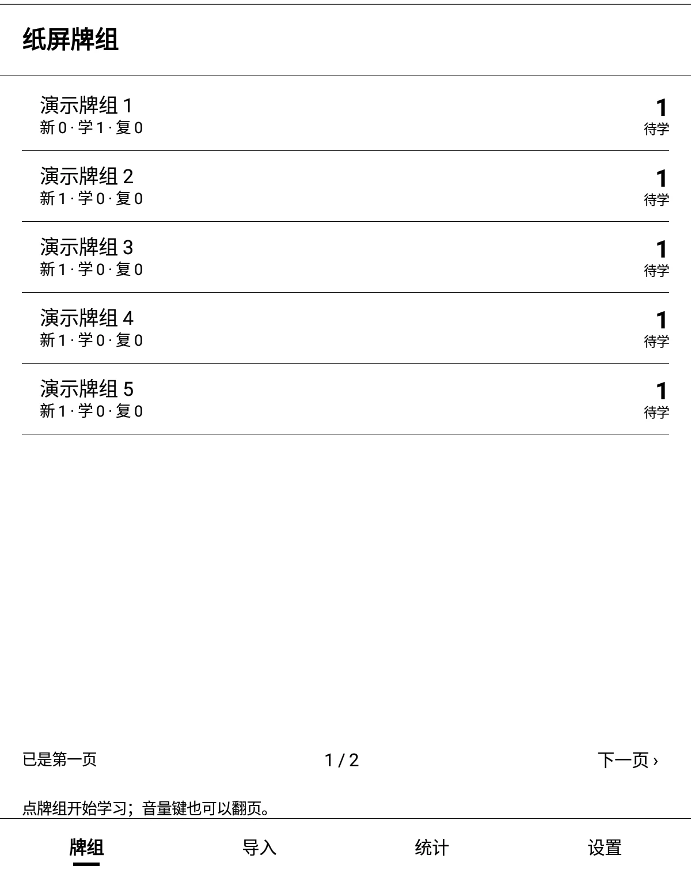
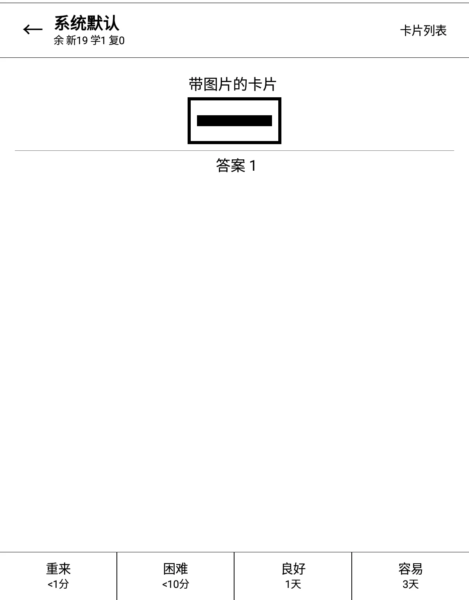
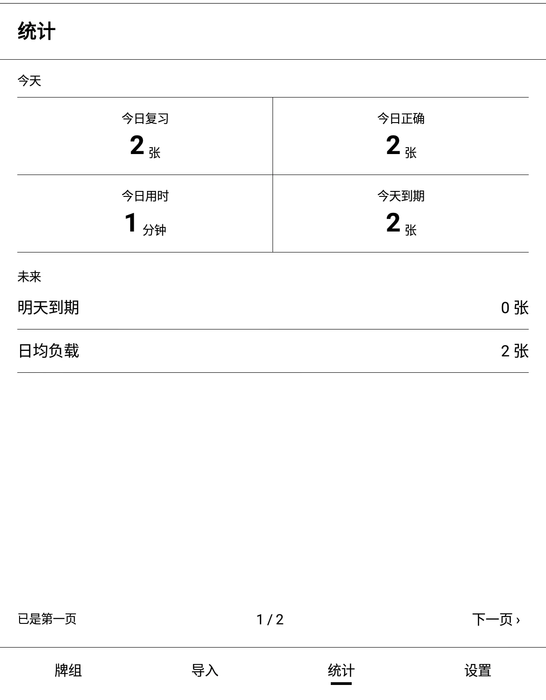

# Inkdeck


[简体中文](README.md) · **English**

[**Website & screenshots**](https://selwiro.github.io/inkdeck/) · [**Download**](https://github.com/Selwiro/inkdeck/releases) · [Issues](https://github.com/Selwiro/inkdeck/issues)

Inkdeck is an unofficial Anki-compatible client for e-ink Android devices; not affiliated with Anki Co., Ltd.

Inkdeck is an Anki-compatible study client rebuilt for e-ink Android devices. Import an `.apkg` deck, page through decks and cards, rate cards under Anki's own scheduling, and check today's statistics; images and audio inside the package display and play inline.

The current 0.1.0 build runs without network access, accounts, ads or analytics, and keeps decks and study records on the device; AnkiWeb sync is planned for phase 2. The interface is rebuilt around e-ink refresh and contrast: no animation, no ripple, fixed black-on-white, full-page redraw. Import, due queue, scheduling and statistics are delegated to rslib, the official Anki Rust backend, so intervals and due dates match the official client.

## Highlights

- **Local-first:** the current build does not sign in or request network access; decks, media and study records stay in app-private storage. Phase 2 will add AnkiWeb sync with an AnkiWeb account and network access.
- **Official scheduling:** import, due queue, SM-2 / FSRS and rating intervals are all handled by rslib, following the deck's own configuration; the app never rewrites your study rhythm.
- **Built for e-ink:** no animation, no ripple, no Spinner; fixed black-on-white; card flips and page changes redraw the whole page, with a manual full refresh to clear ghosting.
- **Paged, not scrolling:** decks and cards use a fixed number of rows per page, with a pager and volume-key paging; no infinite scroll.
- **Four ratings:** Again / Hard / Good / Easy, with interval labels supplied by the backend; volume down reveals the answer or rates Good, volume up rates Again.
- **Card media works:** images and audio inside `.apkg` are imported; images scale proportionally and audio gets a 48dp play button.
- **Three UI languages:** English / Simplified Chinese / Traditional Chinese, following the system by default and pinnable in Settings.
- **Adjustable display:** 18 / 22 / 26sp font sizes, three contrast levels, and an on-demand full refresh.

## Screenshots

Screenshots live on the `gh-pages` branch and are served by the [project site](https://selwiro.github.io/inkdeck/) and the image links below; the main branch does not store images. The 0.1.0 UI is four fixed layouts, all black-on-white with no decoration:

| Decks | Review | Card browse | Today |
|:---:|:---:|:---:|:---:|
|  |  |  |  |

- **Decks:** header "Inkdeck"; one row per deck with the deck name and New / Learning / Due counts on the left, due total on the right; a pager sits below, then the Decks / Import / Stats / Settings navigation.
- **Study:** back arrow, deck name and queue counts, with Card list at the top right; the card body fills the page; the bottom action spans the full width — Show answer on the question side, Again / Hard / Good / Easy on the answer side.
- **Card browse:** opened from the card list; the body fills the remaining height and the bottom toggles between Show answer and Back to question; image cards scale proportionally, audio cards show a 48dp play button.
- **Stats:** page 1 is a 2×2 "Today" grid (reviewed / correct / minutes / due) plus an "Upcoming" key-value block; page 2 shows card composition and the read-only scheduler.

## Features

### Import and browsing

Choose an `.apkg` in Import, or share / open it from a file manager. The file is first copied into app cache and verified, then handed to rslib for an SQLite transaction; a failed import rolls back card and deck writes.

- Supports `.apkg` packages containing `collection.anki2` / `anki21` / `anki21b`; images and audio inside the package are imported too.
- Duplicate packages are detected by content hash; importing again only fills missing cards, never duplicates them, and removes empty decks created by that import.
- Parent and child decks are flattened with indentation; each row shows New, Learning and Due counts.
- Deck and card lists use a fixed page size (6 rows at 18sp, 5/4/3 by screen height at 22/26sp); both the pager and the volume keys page through them.
- The card list shows a plain-text preview of the note's first field; tap any row for the full card. The list never holds the whole collection, so hundreds of cards do not grow memory.

### Review and rating

Tapping a deck goes straight into that deck's study queue, not through the card list first. Tap Show answer to flip the card, then rate it; rslib computes the actual interval and due date from the deck's current scheduler, and the UI only displays them.

- Four ratings: Again / Hard / Good / Easy; the interval label under each comes from the backend.
- Volume down: reveal the answer on the question side, rate Good on the answer side. Volume up: rate Again on the answer side.
- The study header shows the current deck and remaining New / Learning / Due counts; Card list is at the top right.
- A finished round shows a summary (how many cards in each rating); entering the same deck again continues the round counters.
- When a card has no content (missing cloze, empty template, etc.), the Suspend and skip action moves on instead of blocking the whole deck.
- Holding a volume key fires once; at the edges the key is consumed and does not open the system volume panel.

### Statistics

The stats screen takes one snapshot from rslib's statistics API, does not aggregate locally, and draws no charts:

- **Today:** reviewed today, correct today, minutes today, due today.
- **Upcoming:** due tomorrow, daily load.
- **Card composition:** new, learning, young, mature, suspended.
- **Scheduling:** the current deck's scheduler (SM-2 or FSRS), read-only; the app does not offer a switch.

### Display, language and refresh

Settings apply immediately and persist:

| Setting | Options | Notes |
|---|---|---|
| Font size | 18 / 22 / 26sp | CSS px inside cards scales with the body size; a template cannot pin the text to a fixed small size |
| Language | System / English / 简体中文 / 繁體中文 | Changing it restarts the backend so deck language matches the UI |
| Contrast | Standard / Soft / Softer | Only the ink shade changes; paper stays pure white |
| Refresh | Refresh screen now | Flashes a solid frame to force a full redraw and clear ghosting |

The UI is fixed black-on-white; invert and colour themes were removed on 2026-11-18. Greys, shadows, gradients and colour blocks smear into noise or grey bands on e-ink, so none are used. Touch targets are at least 48dp and body text at least 18sp.

### Card rendering and media

Card bodies use a hand-written HTML/CSS subset renderer; there is no WebView:

- Block tags: `div` / `p` / `ul` / `ol` / `li` / `h1`–`h6` / `blockquote` / `pre` / `table` / `hr`. Inline tags: `b` / `strong` / `i` / `em` / `u` / `span` / `br` / `img` / `code`.
- Common CSS properties: `font-size`, `font-weight`, `text-align`, `border`, `padding`, `margin`, `color`, `display:none`, `list-style-type`, plus `tag` / `.class` / `#id` selectors.
- Explicitly unsupported: floats, positioning, flex/grid, percentage widths, gradients, shadows, transforms, pseudo-element layout and `@media`. `background-color` is never painted, to avoid grey bands on e-ink.
- Images render at their aspect ratio (maximum 360dp) and are decoded with longest-edge sampling, so huge photos do not exhaust low-memory devices.
- `[sound:...]` becomes a 48dp play button at its position in the card; only one player is kept at a time and it requests transient audio focus.
- Missing images or audio show “(missing image / audio: filename)” instead of silently leaving a blank.

## Download and installation

Current version is **0.1.0 (versionCode 1)**. It has passed the first on-device acceptance round on the Moaan InkPad X and is published as a **pre-release**. Download:

- [arm64-v8a APK](https://github.com/Selwiro/inkdeck/releases/download/v0.1.0/inkdeck-0.1.0-arm64-v8a.apk)
- [armeabi-v7a APK](https://github.com/Selwiro/inkdeck/releases/download/v0.1.0/inkdeck-0.1.0-armeabi-v7a.apk)
- [SHA256SUMS.txt](https://github.com/Selwiro/inkdeck/releases/download/v0.1.0/SHA256SUMS.txt)

See the [release page](https://github.com/Selwiro/inkdeck/releases/tag/v0.1.0) for notes and checksums.

| Item | Requirement |
|---|---|
| Android | Android 8.0 (API 26) or later |
| CPU | arm64-v8a / armeabi-v7a |
| APK size | about 19–22 MB per ABI (the rslib native library is the bulk) |
| Installation | self-signed APK |

The debug build contains arm64-v8a only; release builds can be split by ABI, with armeabi-v7a for older and 32-bit e-ink devices. APKs signed with different keys cannot overwrite each other, so uninstall the old package before switching keys.

See the Developer guide below for building and installing from source.

## Data and privacy

| Item | Handling |
|---|---|
| Data storage | Deck library and `collection.media/` under the app-private `files/anki/` directory |
| Network | 0.1.0 declares no `INTERNET` permission and the app itself does not go online; network access will only be added when AnkiWeb sync lands in phase 2 |
| Accounts | 0.1.0 has no account, subscription, ads or analytics; phase 2 will sign in with an AnkiWeb account |
| `.apkg` import | Copied, verified and parsed on the device; the temporary package is removed after import |
| Card media | Images and audio are imported with the package and read from local files when rendered |
| System backup | `allowBackup=true`; if Android auto backup is enabled on the device, the system may back up app data. That is controlled by system settings, not an upload by the app |
| Uninstall / clear data | Deletes the app-private directory, including decks and study records |

0.1.0 has no in-app export or backup yet; keep the original `.apkg` before uninstalling or clearing data. Cross-device sync will come with AnkiWeb in phase 2.

## Known limitations

- **Local phase 1 only:** no card creation or editing, no `.colpkg` library import; AnkiWeb sync is phase 2.
- **No export or backup:** study records and decks cannot be exported; recovery relies on the original `.apkg` and the future sync feature.
- **Rendering is a subset:** complex template CSS (flex/grid, floats, background colours, pseudo-element layout, `@media`) will not match the original exactly.
- **Limited device coverage:** on-device acceptance was done on one Moaan InkPad X (Android 8.1, armeabi-v7a); other e-ink models and OS versions have not been checked one by one.
- **Ghosting is not quantified:** users confirmed that a full refresh clears ghosting, but long paging sessions, multiple devices and contrast levels have not been measured.
- **No TTS or charts:** audio only plays files bundled in `.apkg`; statistics are text metrics, not trend charts.
- **Large APK:** the rslib native library is about 18–22 MB and there is no plan to trim it by service yet.

## Roadmap

The project is at **0.1.x** and will proceed in this order:

- **0.1.x:** on-device fixes, layout and display details, test coverage.
- **1.0.0:** first stable release, freezing the phase-1 local feature set.
- **Phase 2:** AnkiWeb integration (sign-in, upload / download, conflict handling).
- **Later:** evaluate card editing and export / backup from user feedback; the jailbroken Kindle build is a separate deliverable sharing the same rslib core.
- Versions follow Semantic Versioning (SemVer).

## Developer guide

### Tech stack

| Technology | Purpose |
|---|---|
| Kotlin | Primary language |
| Jetpack Compose | Declarative UI and custom e-ink components |
| rslib (Anki Rust backend) | Import, deck tree, scheduling, statistics; upstream pinned to tag `26.09.4` |
| JNI bridge (Rust) | JNI channel from Kotlin to rslib |
| protobuf-java (dynamic parsing) | Reads and writes rslib protobuf requests / responses using a descriptor set |
| Gradle 9.6 / AGP 9.5 | Build; AGP 9 has built-in Kotlin support |
| JUnit 4 | JVM unit tests and instrumentation tests |

The architecture is a single Activity plus a Compose screen state machine: `MainViewModel` owns the screen and paging state, `AnkiRepository` serialises rslib calls onto one backend thread, and `InkdeckApp` owns the process-level backend and importer.

### Project structure

```text
inkdeck/
├── app/                         # Android application module
│   └── src/main/java/ink/inkdeck/
│       ├── ui/                  # Compose screens, e-ink components, HTML/CSS rendering
│       ├── data/                # Repository, settings, card and stats models
│       ├── importing/           # .apkg import, duplicate detection, temp-file cleanup
│       └── rslib/               # JNI, protobuf channel and backend lifecycle
├── rslib/
│   ├── build-android.sh         # Fetches upstream anki and cross-compiles the rslib bridge
│   └── bridge/                  # Rust JNI bridge
├── docs/
│   ├── build/                   # Build environment and packaging
│   ├── eink/                    # E-ink design baseline, device matrix, on-device results
│   └── rslib/                   # rslib integration and troubleshooting
├── gradle/libs.versions.toml    # Central dependency versions
├── README.md
├── README.en.md
└── LICENSE
```

`app/src/main/jniLibs/`, `rslib/anki/` and `app/src/main/assets/anki_descriptors.bin` are build artifacts and are not committed.

### Build environment

| Component | Version |
|---|---|
| JDK | 17 |
| Gradle | 9.6.0 (provided by the Wrapper) |
| Android Gradle Plugin | 9.5.0 |
| Kotlin | 2.4.21 |
| compileSdk / targetSdk | 37 / 35 |
| minSdk | 26 |
| build-tools | 36.0.0 (must be declared explicitly in `build.gradle.kts`) |
| NDK | 27.3 (builds the rslib native library) |
| Rust + cargo-ndk | stable + 4.1 (cross-compiles the bridge) |
| protoc | 36.2 |

The verified combination and troubleshooting notes are in [`docs/build/environment.md`](docs/build/environment.md).

### Building the native library

Build the native library first, or after changing rslib / bridge:

```sh
./rslib/build-android.sh                             # arm64-v8a only by default
ABI=arm64-v8a,armeabi-v7a ./rslib/build-android.sh   # both ABIs for release
```

The script fetches the pinned upstream anki tag, builds the bridge and places `librslib_bridge.so` in `app/src/main/jniLibs/`. `ANDROID_NDK_HOME` must be set; install the NDK first if it is missing.

### Building a debug APK

```sh
./gradlew :app:assembleDebug
```

Output:

```text
app/build/outputs/apk/debug/app-debug.apk
```

The debug build contains arm64-v8a only. Install and launch:

```sh
adb install -r app/build/outputs/apk/debug/app-debug.apk
adb shell am start -n ink.inkdeck/.MainActivity
```

### Running tests

```sh
./gradlew :app:testDebugUnitTest
```

The project currently has **24 JVM unit tests** (HTML/CSS subset, first-field preview, width classes and more).

Instrumentation tests need an emulator or device:

```sh
./gradlew :app:connectedDebugAndroidTest
```

There are **20 instrumentation tests** (rslib runtime channel, import, paged browsing, review, statistics, nested-deck search).

### Building a release APK

```sh
./gradlew :app:assembleRelease
```

This produces a universal package of about 39 MB. To split by ABI:

```sh
./gradlew :app:assembleRelease -Pinkdeck.abiSplits=true
```

Outputs go to `app/build/outputs/apk/release/`: `app-arm64-v8a-release.apk` (about 22 MB) and `app-armeabi-v7a-release.apk` (about 18 MB). Release enables R8 and resource shrinking; JNI classes, exception classes and protobuf reflection entry points are kept in `app/proguard-rules.pro`.

### Release signing

Signing reads only environment variables or user-level Gradle properties; keystores and passwords are never committed:

| Environment variable | Purpose |
|---|---|
| `INKDECK_RELEASE_KEYSTORE` | Keystore path |
| `INKDECK_RELEASE_STORE_PASSWORD` | Keystore password |
| `INKDECK_RELEASE_KEY_ALIAS` | Key alias |
| `INKDECK_RELEASE_KEY_PASSWORD` | Key password |

Without them the build falls back to the debug key so `assembleRelease` can still be verified; release packages must use the fixed production key. Changing the key changes the signature, so uninstall the old package first.

### Build mirror

When Google Maven / Maven Central is slow from mainland China:

```sh
INKDECK_ALIYUN=1 ./gradlew :app:assembleDebug
```

The mirror is configured in the root `settings.gradle.kts`; missing artifacts fall back to the official repositories.

### Further reading

- [Build environment and toolchain](docs/build/environment.md)
- [Packaging, ABI, 16 KB page alignment and signing](docs/build/packaging.md)
- [E-ink design baseline and device matrix](docs/eink/README.md)
- [rslib integration and measurements](docs/rslib/integration.md)

### License and trademarks

This project is released under **AGPL-3.0**; see [`LICENSE`](LICENSE). Because it reuses rslib, distributing an APK requires providing the corresponding source: this repository, the upstream anki tag `26.09.4` fetched by `rslib/build-android.sh`, and the bridge source.

“Anki” is a trademark of Anki Co., Ltd. This project uses it only for descriptive compatibility statements and is not affiliated with Anki; the product name and package name contain neither `Anki` nor `E Ink`.

## Sponsor

Feed the author some tokens.


