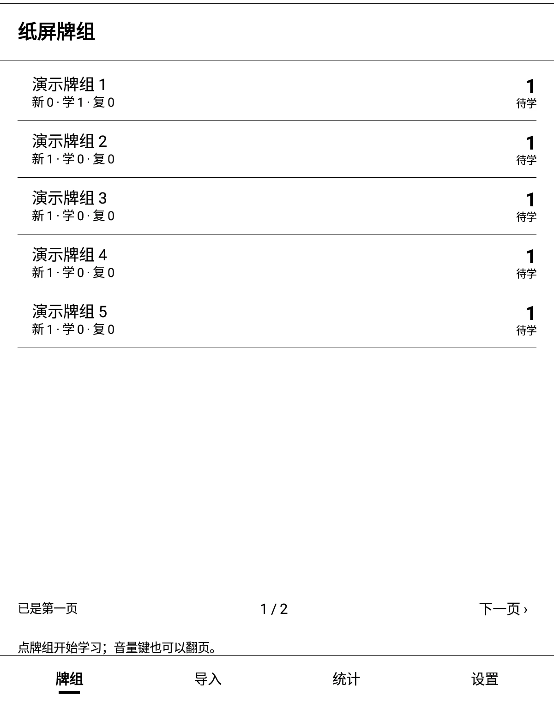
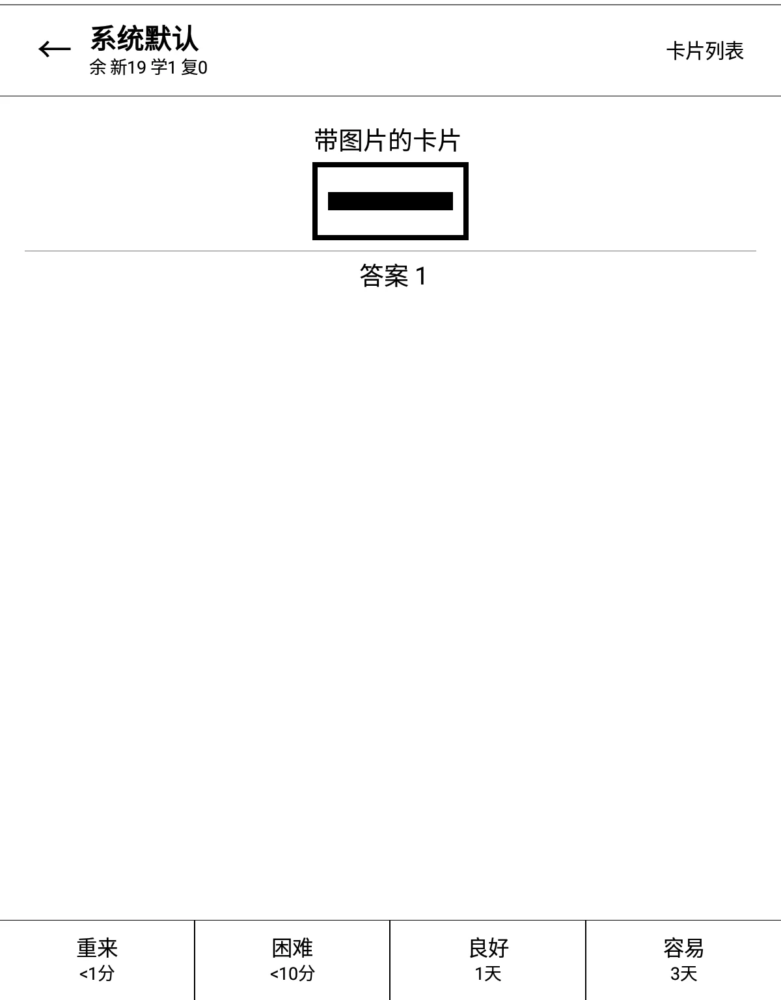
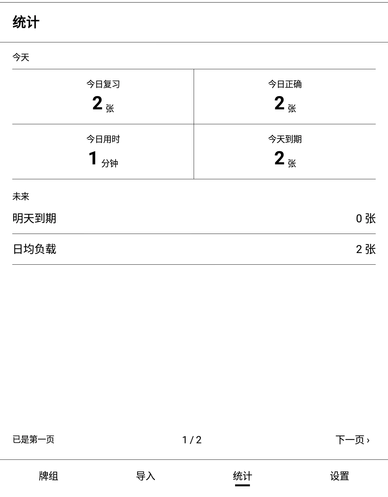

# 纸屏牌组 Inkdeck


**简体中文** · [English](README.en.md)

[**官网与截图**](https://selwiro.github.io/inkdeck/) · [**下载**](https://github.com/Selwiro/inkdeck/releases) · [问题反馈](https://github.com/Selwiro/inkdeck/issues)

Inkdeck is an unofficial Anki-compatible client for e-ink Android devices; not affiliated with Anki Co., Ltd.

纸屏牌组（Inkdeck）是一款为 Android 墨水屏设备重做的 Anki 兼容背诵客户端。导入 `.apkg` 牌组后，可以分页浏览牌组与卡片、按 Anki 调度四档评分、查看今日统计；卡片里的图片与音频也能直接显示和播放。

当前 0.1.0 不联网、无账号、无广告与埋点，牌组与学习记录只保存在本机；二期会接入 AnkiWeb 官方同步。界面按墨水屏的刷新与对比度特性重做：无动画、无涟漪、固定白底黑字、整页重绘；调度与数据模型复用 Anki 官方 Rust 后端 rslib，间隔与到期结果与官方客户端一致。

## 应用特点

- **本地优先：** 当前版本不注册、不登录、不申请网络权限，牌组、媒体与学习记录都留在应用私有目录；二期接入 AnkiWeb 官方同步后，可按需开启账号与联网。
- **复用官方调度：** 导入、到期队列、SM-2 / FSRS 与评分间隔都交给 rslib，跟随牌组原配置，不在应用内改写学习节奏。
- **为墨水屏重做：** 无动画、无涟漪、无 Spinner；固定白底黑字；翻卡与页面切换整页重绘，可手动整屏刷新清残影。
- **分页不滚动：** 牌组与卡片每页固定条数，底部翻页条加音量键翻页；不做无限滚动。
- **四档评分：** 重来 / 困难 / 良好 / 容易，间隔文案由后端给出；音量下翻面或「良好」，音量上「重来」。
- **卡片媒体可用：** `.apkg` 内的图片与音频一并导入；图片等比缩放，音频用 48dp 按钮播放。
- **三种界面语言：** English / 简体中文 / 繁體中文，默认跟随系统，也可在设置页固定。
- **显示可调：** 字号 18 / 22 / 26sp、对比度三档、立即整屏刷新。

## 界面预览

截图存放在 `gh-pages` 分支，由[项目官网](https://selwiro.github.io/inkdeck/)与下面的图片入口提供；主分支不保存图片。0.1.0 的界面可以按四个固定版式理解，全部是白底黑字、无装饰：

| 牌组首页 | 复习评分 | 卡片浏览 | 今日统计 |
|:---:|:---:|:---:|:---:|
|  |  |  |  |

- **牌组首页：** 顶栏「纸屏牌组」，下面每条一行牌组：左侧牌组名与新卡 / 学习中 / 待复习数量，右侧待学总数；底部翻页条，再往下是「牌组 / 导入 / 统计 / 设置」四栏导航。
- **学习页：** 顶栏左侧返回箭头、牌组名与队列余量，右上角「卡片列表」；正文是当前卡片；底部整条操作区——问题面是「显示答案」，答案面是「重来 / 困难 / 良好 / 容易」四段评分。
- **卡片浏览：** 从卡片列表点入，正文占满剩余高度，底部在「显示答案 / 回到问题」之间切换；带图卡片显示等比缩放的图片，带音频卡片显示 48dp 播放按钮。
- **统计：** 第一页是「今天」2×2 指标格（复习 / 正确 / 用时 / 到期）加「未来」键值行；翻到第二页看卡片构成与只读的调度器。

## 功能介绍

### 导入与浏览

在「导入」页选择 `.apkg`，或从文件管理器分享 / 打开 `.apkg` 交给 Inkdeck。文件会先复制到应用缓存并校验，再交给 rslib 在 SQLite 事务里导入；失败会回滚卡片与牌组写入。

- 支持包含 `collection.anki2` / `anki21` / `anki21b` 的 `.apkg`，包内图片与音频一并入库。
- 按文件内容哈希识别重复包；再次导入只补缺失卡片，不会产生重复卡片，并清理本次新建的空牌组。
- 牌组按父子层级缩进展示，每行显示新卡、学习中、待复习数量。
- 牌组与卡片列表都是固定条数分页（18sp 每页 6 条，22/26sp 按屏高降为 5/4/3 条），底部翻页条与音量键都能翻页。
- 卡片列表只显示笔记首字段的纯文本预览，点任意一张进入整卡浏览；列表不保留全量卡片，几百张也不涨内存。

### 复习与评分

点牌组直接进入该牌组的学习队列，不再先跳到卡片列表。问题面点「显示答案」翻面，答案面给出四档评分；具体间隔与到期时间由 rslib 按牌组当前调度器计算，界面只负责展示。

- 四档：重来 / 困难 / 良好 / 容易；每档下方显示后端给出的间隔文案。
- 音量下：问题面翻面，答案面评「良好」；音量上：答案面评「重来」。
- 学习页顶栏显示当前牌组与剩余新卡 / 学习中 / 待复习数量，右上角可进入卡片列表。
- 本轮结束给出一轮小结（四档各多少张）；同一牌组再次进入会延续本轮计数。
- 空卡（填空缺失、模板为空等）无法评分时，可「暂停并跳过」，不会把整副牌卡在一张上。
- 长按音量键只执行一次，不会连续翻面或连续评分；到边界也不把按键漏给系统音量面板。

### 统计

统计页从 rslib 的统计接口一次取数，本地不再聚合，也不画图表：

- **今天：** 今日复习、今日正确、今日用时、今天到期。
- **未来：** 明天到期、日均负载。
- **卡片构成：** 新卡、学习中、年轻卡、成熟卡、已暂停。
- **调度：** 只读展示当前牌组的调度器（SM-2 或 FSRS），应用内不提供切换。

### 显示、语言与刷新

设置页全部即时生效并持久化：

| 设置 | 选项 | 说明 |
|---|---|---|
| 字号 | 18 / 22 / 26sp | 卡片内 CSS 的 px 按字号比例整体缩放，不会出现「设了大字号但模板把正文钉死」 |
| 语言 | 跟随系统 / English / 简体中文 / 繁體中文 | 切换后重启后端，让牌组语言与界面语言一致 |
| 对比度 | 标准 / 柔和 / 更柔和 | 只调整墨色深浅，纸色始终保持纯白 |
| 刷新 | 立即整屏刷新 | 闪一帧纯色逼出整屏重绘，用来清除残影 |

界面固定白底黑字，2026-11-18 起移除了反色 / 配色切换；水墨屏上灰阶、阴影、渐变和色块会糊成噪点或灰带，因此一律不用。点击目标不小于 48dp，正文不小于 18sp。

### 卡片渲染与媒体

卡片正文使用自写的 HTML/CSS 子集渲染器，不引入 WebView：

- 支持 `div` / `p` / `ul` / `ol` / `li` / `h1`–`h6` / `blockquote` / `pre` / `table` / `hr` 等块级标签，以及 `b` / `strong` / `i` / `em` / `u` / `span` / `br` / `img` / `code` 等行内标签。
- 支持 `font-size`、`font-weight`、`text-align`、`border`、`padding`、`margin`、`color`、`display:none`、`list-style-type` 等常用属性，以及 `tag` / `.class` / `#id` 选择器。
- 明确不支持浮动、定位、flex/grid、百分比宽度、渐变、阴影、变换、伪元素布局与 `@media`；`background-color` 一律不画，避免墨水屏出现灰带。
- 图片按原比例显示（最高 360dp），按最长边采样解码，避免低内存设备被大图打爆。
- `[sound:...]` 在卡片对应位置生成 48dp 播放按钮；同一时间只保留一个播放器，并申请短暂音频焦点。
- 缺失的图片 / 音频显示「（缺图 / 缺音频：文件名）」，不静默留白。

## 获取与安装

当前版本为 **0.1.0（versionCode 1）**，已完成墨案 InkPad X 一期真机验收，并以**测试版（pre-release）**发布。下载：

- [arm64-v8a APK](https://github.com/Selwiro/inkdeck/releases/download/v0.1.0/inkdeck-0.1.0-arm64-v8a.apk)
- [armeabi-v7a APK](https://github.com/Selwiro/inkdeck/releases/download/v0.1.0/inkdeck-0.1.0-armeabi-v7a.apk)
- [SHA256SUMS.txt](https://github.com/Selwiro/inkdeck/releases/download/v0.1.0/SHA256SUMS.txt)

也可以从 [Releases 页面](https://github.com/Selwiro/inkdeck/releases/tag/v0.1.0) 查看说明与校验值。

| 项目 | 要求 |
|---|---|
| Android 版本 | Android 8.0（API 26）及以上 |
| CPU 架构 | arm64-v8a / armeabi-v7a |
| APK 大小 | 单 ABI 约 19–22 MB（rslib 原生库占主要体积） |
| 安装方式 | 自签名 APK |

Debug 包只含 arm64-v8a，适合日常调试；Release 包可按 ABI 拆分，老设备和 32 位墨水屏用 armeabi-v7a。使用不同签名密钥构建的 APK 不能互相覆盖安装，换签名前需要先卸载旧包。

从源码构建与安装见下文「开发者文档」。

## 数据与隐私

| 项目 | 处理方式 |
|---|---|
| 数据存储 | 应用私有目录 `files/anki/` 下的牌组库与 `collection.media/` |
| 网络 | 0.1.0 未声明 `INTERNET` 权限，应用自身不联网；二期接入 AnkiWeb 后才会申请网络访问 |
| 账号 | 0.1.0 无账号、无订阅、无广告、无埋点统计；二期接入 AnkiWeb 后使用 AnkiWeb 账号登录 |
| `.apkg` 导入 | 在设备端复制、校验、解析；临时包在导入后清理 |
| 卡片媒体 | 图片与音频随包入库，渲染时直接读本地文件 |
| 系统备份 | `allowBackup=true`；若设备开启 Android 自动备份，系统可能备份应用数据，这由系统设置控制，不是应用上传 |
| 卸载 / 清数据 | 会删除应用私有目录，牌组与学习记录一并丢失 |

0.1.0 还没有应用内导出或备份功能，卸载或清除数据前请保留原始 `.apkg`；二期接入 AnkiWeb 后再补跨设备同步。

## 已知限制

- **当前只做本地一期：** 没有新建 / 编辑卡片，不支持 `.colpkg` 整库导入；AnkiWeb 同步在二期。
- **没有导出与备份：** 不能导出学习记录或牌组；数据恢复依赖原始 `.apkg` 与后续同步功能。
- **渲染是子集：** 复杂模板 CSS（flex/grid、浮动、背景色、伪元素布局、`@media`）不会按原样呈现。
- **设备覆盖有限：** 只在一台墨案 InkPad X（Android 8.1，armeabi-v7a）上完成真机验收；其他墨水屏机型、系统版本尚未逐台验证。
- **残影未量化：** 整屏刷新清残影已由用户确认，但长翻页、多机型、不同对比度档的残影没有做量化测试。
- **无 TTS / 统计图表：** 音频只播放 `.apkg` 自带文件，统计是文字指标，不画趋势图。
- **安装包偏大：** rslib 原生库约 18–22 MB，短期不打算按服务裁剪。

## 开发计划

项目当前处于 **0.1.x** 阶段，后续按下面的顺序推进：

- **0.1.x：** 真机问题修复、版式与显示细节、测试覆盖。
- **1.0.0：** 第一个稳定版本，冻结一期本地能力。
- **二期：** 对接 AnkiWeb（登录、上传 / 下载、冲突处理）。
- **之后：** 按用户反馈评估卡片编辑、导出 / 备份等；越狱 Kindle 版作为独立成果推进，与 Android 版共用 rslib 核心。
- 版本号按语义化版本（SemVer）管理。

## 开发者文档

### 技术栈

| 技术 | 用途 |
|---|---|
| Kotlin | 主要开发语言 |
| Jetpack Compose | 声明式 UI 与自绘墨水屏组件 |
| rslib（Anki Rust 后端） | 导入、牌组树、调度、统计；上游固定 tag `26.09.4` |
| JNI bridge（Rust） | Kotlin 调用 rslib 的 JNI 通道 |
| protobuf-java（动态解析） | 按 descriptor 集合读写 rslib 的 protobuf 请求 / 响应 |
| Gradle 9.6 / AGP 9.5 | 构建；AGP 9 起内置 Kotlin 支持 |
| JUnit 4 | JVM 单元测试与 instrumentation 测试 |

架构是单 Activity + Compose 页面状态机：`MainViewModel` 持有页面与分页状态，`AnkiRepository` 把 rslib 调用串行到一条后端线程，`InkdeckApp` 持有进程级后端与导入器。

### 项目结构

```text
inkdeck/
├── app/                         # Android 应用模块
│   └── src/main/java/ink/inkdeck/
│       ├── ui/                  # Compose 页面、墨水屏组件、HTML/CSS 渲染
│       ├── data/                # 仓库、设置、卡面与统计模型
│       ├── importing/           # .apkg 导入、去重、临时文件清理
│       └── rslib/               # JNI、protobuf 通道与后端生命周期
├── rslib/
│   ├── build-android.sh         # 拉取上游 anki 并交叉编译 rslib bridge
│   └── bridge/                  # Rust JNI bridge
├── docs/
│   ├── build/                   # 构建环境与打包
│   ├── eink/                    # 墨水屏设计基线、设备矩阵、真机结论
│   └── rslib/                   # rslib 接入与排错
├── gradle/libs.versions.toml    # 依赖版本集中管理
├── README.md
├── README.en.md
└── LICENSE
```

`app/src/main/jniLibs/`、`rslib/anki/` 与 `app/src/main/assets/anki_descriptors.bin` 是构建产物，不入库。

### 构建环境

| 组件 | 版本 |
|---|---|
| JDK | 17 |
| Gradle | 9.6.0（由 Wrapper 提供） |
| Android Gradle Plugin | 9.5.0 |
| Kotlin | 2.4.21 |
| compileSdk / targetSdk | 37 / 35 |
| minSdk | 26 |
| build-tools | 36.0.0（必须在 `build.gradle.kts` 显式声明） |
| NDK | 27.3（编译 rslib 原生库） |
| Rust + cargo-ndk | stable + 4.1（交叉编译 bridge） |
| protoc | 36.2 |

完整的已验证组合与踩坑记录见 [`docs/build/environment.md`](docs/build/environment.md)。

### 构建原生库

首次构建或改动 rslib / bridge 后，先编译原生库：

```sh
./rslib/build-android.sh                             # 默认只编 arm64-v8a
ABI=arm64-v8a,armeabi-v7a ./rslib/build-android.sh   # 发布包需要两个 ABI
```

脚本会拉取上游 anki 固定 tag、编译 bridge，并把 `librslib_bridge.so` 放到 `app/src/main/jniLibs/`。需要设置 `ANDROID_NDK_HOME`，缺少 NDK 时先按环境文档安装。

### 构建 Debug APK

```sh
./gradlew :app:assembleDebug
```

产物：

```text
app/build/outputs/apk/debug/app-debug.apk
```

Debug 包只含 arm64-v8a。安装并启动：

```sh
adb install -r app/build/outputs/apk/debug/app-debug.apk
adb shell am start -n ink.inkdeck/.MainActivity
```

### 运行测试

```sh
./gradlew :app:testDebugUnitTest
```

当前包含 **24 项 JVM 单元测试**（HTML/CSS 子集、卡片首字段预览、宽度档位等）。

Instrumentation 测试需要模拟器或真机：

```sh
./gradlew :app:connectedDebugAndroidTest
```

当前包含 **20 项 instrumentation 测试**（rslib 运行时通道、导入、分页浏览、复习、统计、嵌套牌组搜索）。

### 构建 Release APK

```sh
./gradlew :app:assembleRelease
```

默认产出 universal 包，约 39 MB。按 ABI 拆分：

```sh
./gradlew :app:assembleRelease -Pinkdeck.abiSplits=true
```

产物在 `app/build/outputs/apk/release/`：`app-arm64-v8a-release.apk`（约 22 MB）与 `app-armeabi-v7a-release.apk`（约 18 MB）。Release 开启 R8 与资源压缩，JNI 类、异常类与 protobuf 反射入口已在 `app/proguard-rules.pro` 保留。

### Release 签名

签名配置只从环境变量或用户级 Gradle 属性读取，密钥库与口令不入库：

| 环境变量 | 用途 |
|---|---|
| `INKDECK_RELEASE_KEYSTORE` | 密钥库路径 |
| `INKDECK_RELEASE_STORE_PASSWORD` | 密钥库口令 |
| `INKDECK_RELEASE_KEY_ALIAS` | 密钥别名 |
| `INKDECK_RELEASE_KEY_PASSWORD` | 密钥口令 |

未配置时回退到 debug 签名，保证 `assembleRelease` 随时可验证；发布包必须使用固定的正式密钥。换密钥等于换签名，已安装的旧包需要先卸载。

### 构建镜像

大陆网络访问 Google Maven / Maven Central 不稳定时：

```sh
INKDECK_ALIYUN=1 ./gradlew :app:assembleDebug
```

镜像配置在根 `settings.gradle.kts`，缺失的 artifact 会自动回落到官方源。

### 延伸文档

- [构建环境与工具链](docs/build/environment.md)
- [打包、ABI、16 KB 页对齐与签名](docs/build/packaging.md)
- [墨水屏设计基线与设备矩阵](docs/eink/README.md)
- [rslib 接入方案与实测](docs/rslib/integration.md)

### 许可证与商标

本项目以 **AGPL-3.0** 发布，见 [`LICENSE`](LICENSE)。因复用 rslib，分发 APK 时需同时提供对应源码：本仓库源码、`rslib/build-android.sh` 取到的上游 anki 固定 tag `26.09.4`，以及 bridge 源码。

「Anki」为 Anki Co., Ltd. 的商标，本项目仅作兼容性描述使用，与 Anki 官方无关联；产品名与包名不包含 `Anki` 或 `E Ink`。

## 赞助

给作者喂点 token。


